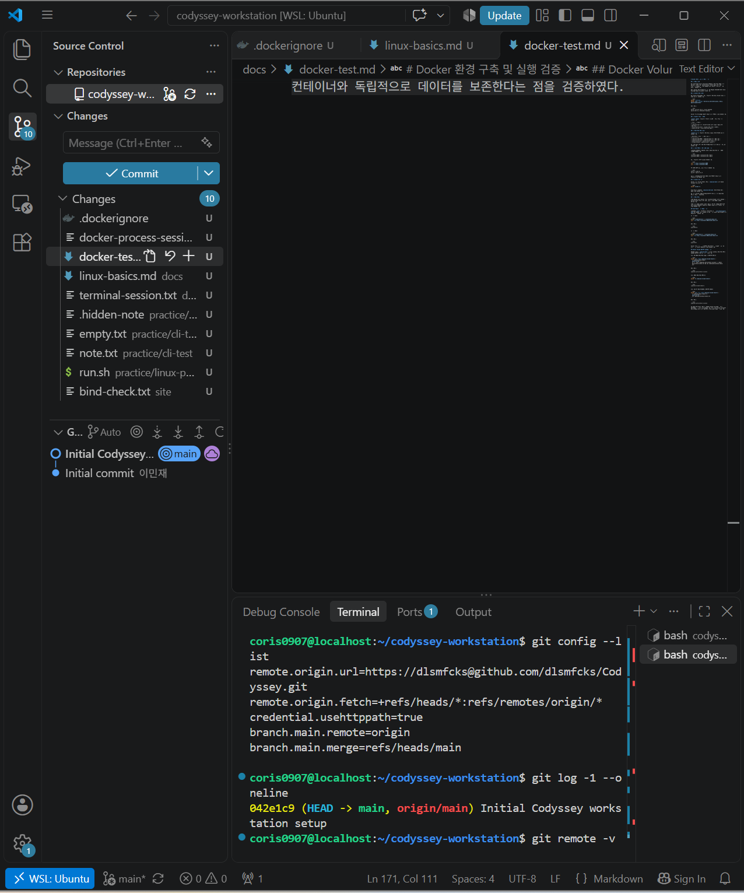

# Codyssey - 개발 워크스테이션 구축

## 1. 프로젝트 소개

Codyssey 미션 1 '내 컴퓨터에 개발자용 작업실 꾸미기'를 진행하면서 Linux, Docker, Git을 활용한 개발 환경을 구축했다.

Windows에서 WSL Ubuntu를 사용하고, VS Code를 연결하여 Linux 환경에서 작업할 수 있도록 설정했다. 이후 Dockerfile을 작성해 Nginx 웹 서버를 실행하고, 포트 매핑을 통해 브라우저에서 접속되는지 확인했다.

Docker의 Bind Mount와 Volume도 직접 사용해 보면서 파일 변경이 어떻게 반영되는지, 컨테이너를 삭제해도 데이터가 남아 있는지 확인했다.

실습 과정에서 사용한 명령어와 실행 결과는 `docs/` 폴더에 정리했다.

## 2. 개발 환경

| 항목 | 사용 환경 |
|---|---|
| 운영체제 | Windows + WSL2 Ubuntu |
| Shell | Bash |
| 개발 도구 | VS Code (WSL 연결) |
| Docker | Docker Desktop 29.9.2 |
| Git | 2.53.0 |
| 웹 서버 | Nginx 1.31.8 |
| Docker 기반 이미지 | nginx:alpine |
| GitHub | [Codyssey 저장소](https://github.com/dlsmfcks/Codyssey) |

Docker는 WSL Ubuntu 터미널에서 실행했으며, Docker Desktop의 엔진과 정상적으로 연결되는 것을 확인했다.

## 3. 수행 내용

미션에서 요구한 항목을 하나씩 실습하고 결과를 기록했다.

| 실습 항목 | 진행 결과 |
|---|---|
| Linux 기본 명령어 및 파일 관리 | 완료 |
| 파일 및 디렉터리 권한 변경 | 완료 |
| Docker 설치 및 엔진 점검 | 완료 |
| hello-world 및 Ubuntu 컨테이너 실행 | 완료 |
| Docker 이미지 및 컨테이너 관리 | 완료 |
| Docker exec / attach 비교 | 완료 |
| Dockerfile 작성 및 커스텀 이미지 빌드 | 완료 |
| 웹 서버 실행 및 포트 매핑 | 완료 |
| Bind Mount 변경 반영 | 완료 |
| Docker Volume 데이터 영속성 | 완료 |
| Git 설정 및 GitHub 저장소 연결 | 완료 |
| VS Code WSL 및 Git 저장소 연결 | 완료 |

### Linux 기본 명령어와 권한

`pwd`, `ls`, `mkdir`, `touch`, `cp`, `mv`, `rm` 등의 명령어를 이용해 파일과 디렉터리를 직접 생성하고 관리했다.

파일 권한 실습에서는 `run.sh`에 644 권한을 설정하고 실행을 시도했다.

```bash
chmod 644 run.sh
./run.sh
```

실행 결과:

```text
bash: ./run.sh: Permission denied
```

실행 권한이 없어서 발생한 오류였다. 이후 권한을 755로 변경하니 정상적으로 실행됐다.

```bash
chmod 755 run.sh
./run.sh
```

```text
Permission test success
```

디렉터리도 755에서 700으로 변경하여 소유자와 다른 사용자의 접근 권한 차이를 확인했다.

또한 절대 경로는 `/home/...`처럼 루트 디렉터리를 기준으로 하고, 상대 경로는 현재 위치를 기준으로 한다는 점을 실제 파일 경로로 확인했다.

관련 기록:

- [Linux 권한 실습](docs/linux-basics.md)
- [터미널 명령어 실행 기록](docs/terminal-session.txt)

## 4. Docker 웹 서버 구축

### Dockerfile 작성

웹 서버는 별도의 복잡한 설정 없이 실행할 수 있도록 공식 Nginx 이미지를 기반으로 구성했다.

```dockerfile
FROM nginx:alpine

LABEL org.opencontainers.image.title="codyssey-workstation-web"

COPY site/ /usr/share/nginx/html/

EXPOSE 80
```

`FROM`으로 Nginx 이미지를 가져오고, `COPY`를 이용해 직접 작성한 HTML 파일을 웹 서버 디렉터리에 복사했다. `EXPOSE 80`은 컨테이너 내부에서 사용할 포트를 명시한 것이다.

### 이미지 빌드 및 실행

프로젝트 폴더에서 Docker 이미지를 빌드했다.

```bash
docker build -t codyssey-web:1.0 .
```

빌드한 이미지를 이용해 Nginx 컨테이너를 실행했다. 아래는 8080 포트 실행 예시다.

```bash
docker run -d --name codyssey-web-demo \
  -p 127.0.0.1:8080:80 codyssey-web:1.0
```

이 명령어는 8080 포트가 비어 있는 환경에서 실행해야 한다.

실습에서는 8080과 8081 포트를 사용했고, 이후 Dockerfile을 다시 빌드하여 8082 포트에서도 접속을 확인했다.

```bash
curl -I http://localhost:8080
curl -I http://localhost:8081
```

두 포트 모두 다음 응답을 반환했다.

```text
HTTP/1.1 200 OK
Server: nginx/1.31.8
```

브라우저에서도 직접 작성한 웹페이지가 정상적으로 표시됐다.

### 웹 서버 실행 화면

**8080 포트**


**8081 포트**


포트 매핑은 호스트에서 사용하는 포트와 컨테이너 내부의 서비스 포트를 연결하기 위해 필요하다.

## 5. Bind Mount와 Docker Volume

### Bind Mount

Bind Mount는 호스트의 파일을 컨테이너 내부에서 사용할 수 있도록 연결하는 방식이다.

이번 실습에서는 WSL의 `site/` 폴더를 Nginx의 웹 디렉터리에 연결했다.

```text
호스트: site/
       ↓
컨테이너: /usr/share/nginx/html
```

호스트에서 파일을 수정했을 때 컨테이너에서도 변경된 내용이 보이는지 확인했다.

```bash
printf 'bind-before\n' > site/bind-check.txt
curl -fsS http://localhost:8081/bind-check.txt
```

결과:

```text
bind-before
```

파일 내용을 변경한 후 다시 요청했다.

```bash
printf 'bind-after\n' > site/bind-check.txt
curl -fsS http://localhost:8081/bind-check.txt
```

결과:

```text
bind-after
```

Docker 이미지를 다시 빌드하거나 컨테이너를 재시작하지 않았는데도 변경 내용이 반영됐다.

### Docker Volume

Volume은 Docker가 관리하는 저장 공간으로, 컨테이너를 삭제해도 데이터를 유지할 수 있다.

기존에 생성한 `codyssey-data` 볼륨을 이용해 영속성을 확인했다.

첫 번째 컨테이너에서 파일을 생성했다.

```bash
docker run --name codyssey-volume-check-1 \
  -v codyssey-data:/data \
  ubuntu:24.04 \
  sh -c 'echo "Codyssey persistence success" > /data/persistence-check.txt && cat /data/persistence-check.txt'
```

출력:

```text
Codyssey persistence success
```

첫 번째 컨테이너를 삭제한 뒤 새로운 컨테이너에서 같은 파일을 확인했다.

```bash
docker rm codyssey-volume-check-1

docker run --rm --name codyssey-volume-check-2 \
  -v codyssey-data:/data:ro \
  ubuntu:24.04 \
  cat /data/persistence-check.txt
```

출력:

```text
Codyssey persistence success
```

컨테이너를 삭제한 후에도 기존 데이터가 유지됐다.

이 실습을 통해 Bind Mount는 개발 중 파일 변경 사항을 반영하는 데 유용하고, Volume은 컨테이너와 별도로 데이터를 관리하는 데 유용하다는 차이를 확인했다.

상세 기록: [Docker 실습 결과](docs/docker-test.md)

## 6. Docker 컨테이너 관리

웹 서버 실행뿐만 아니라 컨테이너의 상태를 확인하고 관리하는 명령어도 실습했다.

```bash
docker images
docker ps -a
docker logs --tail 20 codyssey-web-8080
docker stats --no-stream codyssey-web-8080
```

`docker logs`에서는 Nginx의 실행 기록과 브라우저 요청을 확인했고, `docker stats`에서는 CPU와 메모리 사용량을 확인했다.

Ubuntu 컨테이너에서는 `exec`와 `attach`의 차이도 확인했다.

`exec`로 실행한 명령이 종료된 후에도 컨테이너는 실행 상태를 유지했다.

```text
docker inspect 결과: true
```

반면 `attach`로 연결한 컨테이너는 주 프로세스가 종료된 후 다음 상태로 변경됐다.

```text
main-process-finished
exited
```

이를 통해 `exec`는 실행 중인 컨테이너에 별도 프로세스를 실행하고, `attach`는 기존 주 프로세스에 연결한다는 차이를 확인했다.

관련 기록:

- [Docker exec / attach 실행 기록](docs/docker-process-session.txt)
- [Docker 빌드 기록](docs/docker-build-session.txt)
- [Docker 운영 명령어 및 최종 검증](docs/final-verification-session.txt)

## 7. Git 및 GitHub 연결

Git을 이용해 프로젝트의 변경 사항을 관리하고, GitHub 저장소에 업로드했다.

Git은 로컬에서 코드 변경 이력을 관리하는 도구이고, GitHub는 원격 저장소를 통해 코드를 공유하고 협업할 수 있는 플랫폼이다.

이번 실습에서는 `main` 브랜치를 사용했으며, VS Code를 WSL Ubuntu에 연결한 상태에서 Git 명령어를 실행했다.

```bash
git branch --show-current
git remote -v
git status
```

원격 저장소는 `dlsmfcks/Codyssey`로 연결했다.

**VS Code 연동 화면**



## 8. 실습 중 발생한 문제

### GitHub Push 인증 오류

처음 GitHub에 코드를 업로드할 때 403 오류가 발생했다.

```text
Permission to dlsmfcks/Codyssey.git denied to cnu202502195.
```

기존 학교 과제에서 사용하던 GitHub 계정으로 인증되고 있어서, 현재 저장소에 코드를 업로드할 권한이 없었다.

기존 계정의 인증 정보를 삭제하면 다른 과제에 영향을 줄 수 있다고 생각해, 현재 프로젝트에서 인증 정보를 구분하는 방법을 사용했다.

```bash
git config --local credential.useHttpPath true
git remote set-url origin https://dlsmfcks@github.com/dlsmfcks/Codyssey.git
```

이후 올바른 계정으로 인증해 `git push`에 성공했다.

### Docker 이미지 빌드 명령어 오류

Dockerfile을 다시 빌드하는 과정에서 아래 명령어를 입력했다.

```bash
docker build -t codyssey-web:verify
```

그런데 빌드할 경로가 지정되지 않았다는 오류가 발생했다.

```text
docker buildx build requires 1 argument
```

마지막에 현재 디렉터리를 의미하는 `.`을 빠뜨린 것이 원인이었다.

```bash
docker build -t codyssey-web:verify .
```

명령어를 수정한 뒤 이미지 빌드에 성공했으며, 8082 포트로 실행해 HTTP 200 응답까지 확인했다.

이외에 Linux 파일 실행 권한 오류도 실습하면서 확인했다.

[트러블슈팅 상세 내용](docs/troubleshooting.md)

## 9. 실습 결과 및 정리

이번 미션에서는 WSL Ubuntu에서 Linux 명령어를 사용하고, Docker를 통해 웹 서버를 실행하는 과정까지 직접 진행했다.

처음에는 Docker 이미지와 컨테이너가 어떻게 다른지, 포트를 연결해야 하는 이유가 무엇인지 헷갈리는 부분이 있었다. 하지만 이미지를 빌드하고 컨테이너를 실행한 뒤 브라우저에서 직접 확인하면서 전체적인 흐름을 이해할 수 있었다.

특히 Bind Mount와 Volume을 실습하면서 컨테이너를 실행하는 것뿐만 아니라 파일과 데이터를 어떻게 관리하는지도 중요하다는 것을 알게 됐다.

GitHub 연결 과정에서도 계정 인증 문제를 해결하면서 Git 설정과 저장소 접근 권한의 차이를 확인할 수 있었다.

앞으로는 이번에 구축한 환경을 바탕으로 Docker Compose와 여러 컨테이너를 함께 사용하는 방법도 학습해 볼 계획이다.

## 참고 자료

- [Docker 공식 문서](https://docs.docker.com/)
- [Dockerfile Reference](https://docs.docker.com/reference/dockerfile/)
- [Git 공식 문서](https://git-scm.com/doc)
- [VS Code WSL 가이드](https://code.visualstudio.com/docs/remote/wsl)
