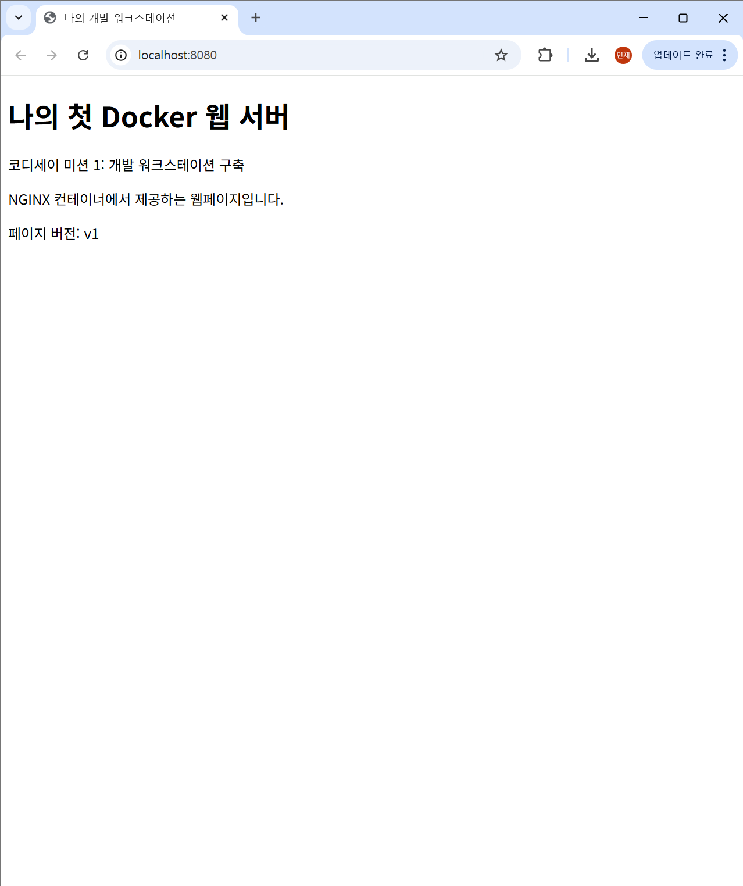
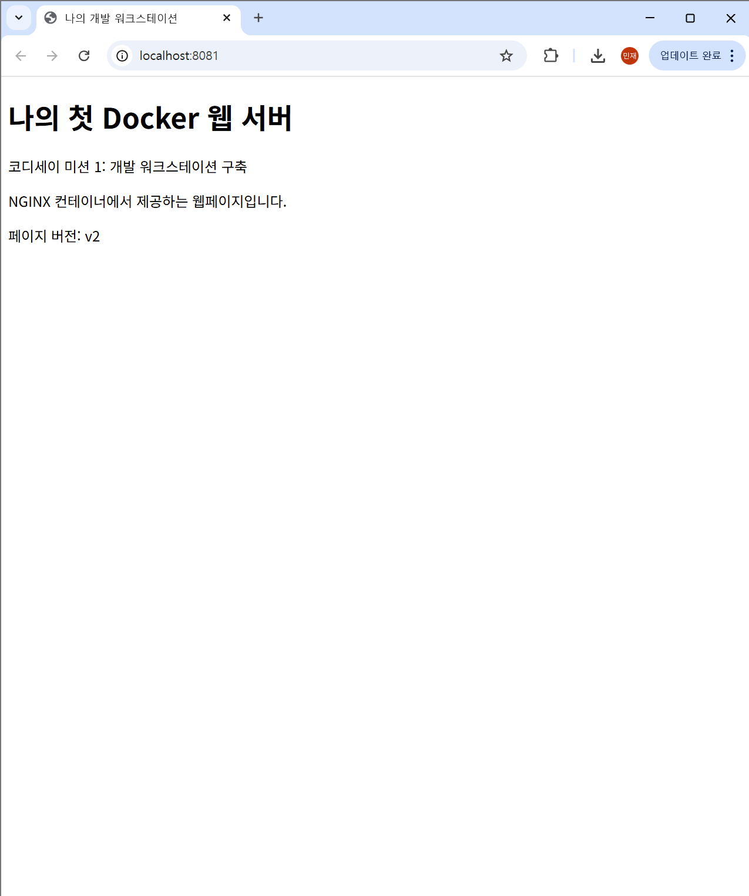

# Docker 환경 구축 및 실행 검증

## 1. 실습 개요

WSL Ubuntu와 Docker Desktop을 연동하여 컨테이너 기반 개발 환경을 구축하였다. Dockerfile을 이용해 Nginx 웹 서버 이미지를 생성하고, 포트 매핑을 통해 웹페이지에 접근할 수 있는지 확인하였다.

또한 Docker 컨테이너와 스토리지의 동작을 확인하기 위해 Bind Mount와 Named Volume을 활용하였다.

## 2. Docker 실행 환경

WSL Ubuntu 터미널에서 다음 명령어를 실행하여 Docker 설치 및 엔진 상태를 확인하였다.

```bash
docker --version
docker info --format 'Server={{.ServerVersion}}, OS={{.OperatingSystem}}'
```

실행 결과:

```text
Docker version 29.9.2, build a82e528
Server=29.9.2, OS=Docker Desktop
```

Docker 클라이언트와 엔진이 정상적으로 연결된 것을 확인하였다.

## 3. Docker 이미지 확인

`docker images` 명령어를 이용해 로컬에 저장된 이미지를 확인하였다.

| 이미지 | 용도 |
|---|---|
| codyssey-web:1.0 | Dockerfile을 통해 생성한 Nginx 웹 서버 이미지 |
| hello-world:latest | Docker 실행 환경 테스트 |
| ubuntu:24.04 | Linux 컨테이너 실습 |

## 4. 컨테이너 실행 상태

`docker ps -a` 명령어를 실행하여 생성된 컨테이너의 상태를 확인하였다.

| 컨테이너 | 이미지 | 실행 상태 |
|---|---|---|
| codyssey-web-8080 | codyssey-web:1.0 | 실행 중 |
| codyssey-web-bind | codyssey-web:1.0 | 실행 중 |
| ubuntu-practice | ubuntu:24.04 | 종료됨 |
| volume-second | ubuntu:24.04 | 종료됨 |

두 개의 Nginx 웹 서버 컨테이너가 정상적으로 실행되고 있음을 확인하였다.

## 5. 포트 연결 및 웹 서버 접속 검증

호스트의 8080번과 8081번 포트를 각각 컨테이너 내부 80번 포트에 연결하였다.

```text
localhost:8080 → Container:80 → Nginx
localhost:8081 → Container:80 → Nginx
```

다음 명령어로 HTTP 응답을 확인하였다.

```bash
curl -I http://localhost:8080
curl -I http://localhost:8081
```

두 요청 모두 다음 상태 코드를 반환하였다.

```text
HTTP/1.1 200 OK
Server: nginx/1.31.8
```

따라서 호스트와 컨테이너 간의 포트 연결이 정상적으로 이루어졌음을 확인하였다.

## 6. Docker 스토리지

Docker 볼륨 목록을 확인한 결과 `codyssey-data`라는 Named Volume이 존재하였다.

```bash
docker volume ls
```

Bind Mount 테스트용 `codyssey-web-bind` 컨테이너도 실행 중인 것을 확인하였다.

스토리지의 실제 연결 정보와 데이터 보존 여부는 추가 확인 결과를 기록할 예정이다.

## 7. 실습 결과

이번 실습을 통해 Docker 이미지와 컨테이너의 차이를 확인하고, Dockerfile을 이용한 웹 서버 구성 및 포트 매핑 과정을 수행하였다.

특히 서로 다른 호스트 포트로 실행한 두 웹 서버가 모두 HTTP 200 응답을 반환하여 네트워크 연결이 정상적으로 이루어지는 것을 확인하였다.

## Bind Mount 변경 반영 검증

호스트의 `site/` 디렉터리를 컨테이너 내부 `/usr/share/nginx/html`에 연결하였다. 호스트 파일의 변경 사항이 컨테이너에 즉시 반영되는지 확인하였다.

**변경 전**

```bash
printf 'bind-before\n' > site/bind-check.txt
curl -fsS http://localhost:8081/bind-check.txt
```

실행 결과:

```text
bind-before
```

**변경 후**

```bash
printf 'bind-after\n' > site/bind-check.txt
curl -fsS http://localhost:8081/bind-check.txt
```

실행 결과:

```text
bind-after
```

Docker 이미지를 재빌드하거나 컨테이너를 재시작하지 않고도 파일 변경 내용이 반영되는 것을 확인하였다.

## Docker Volume 데이터 영속성 검증

기존에 생성한 `codyssey-data` 볼륨을 사용하여 컨테이너 삭제 전후의 데이터 보존 여부를 검증하였다.

**1. 첫 번째 컨테이너 생성 및 데이터 기록**

```bash
docker run --name codyssey-volume-check-1 \
  -v codyssey-data:/data \
  ubuntu:24.04 \
  sh -c 'echo "Codyssey persistence success" > /data/persistence-check.txt && cat /data/persistence-check.txt'
```

실행 결과:

```text
Codyssey persistence success
```

**2. 기존 컨테이너 삭제**

```bash
docker rm codyssey-volume-check-1
```

실행 결과:

```text
codyssey-volume-check-1
```

**3. 새로운 컨테이너에서 데이터 확인**

```bash
docker run --rm --name codyssey-volume-check-2 \
  -v codyssey-data:/data:ro \
  ubuntu:24.04 \
  cat /data/persistence-check.txt
```

실행 결과:

```text
Codyssey persistence success
```

첫 번째 컨테이너를 삭제한 뒤에도 Named Volume에 저장된 데이터가 유지되는 것을 확인하였다. 이를 통해 Docker Volume이 컨테이너와 독립적으로 데이터를 보존한다는 점을 검증하였다.

## 웹 서버 접속 화면

### 8080 포트



### 8081 포트

